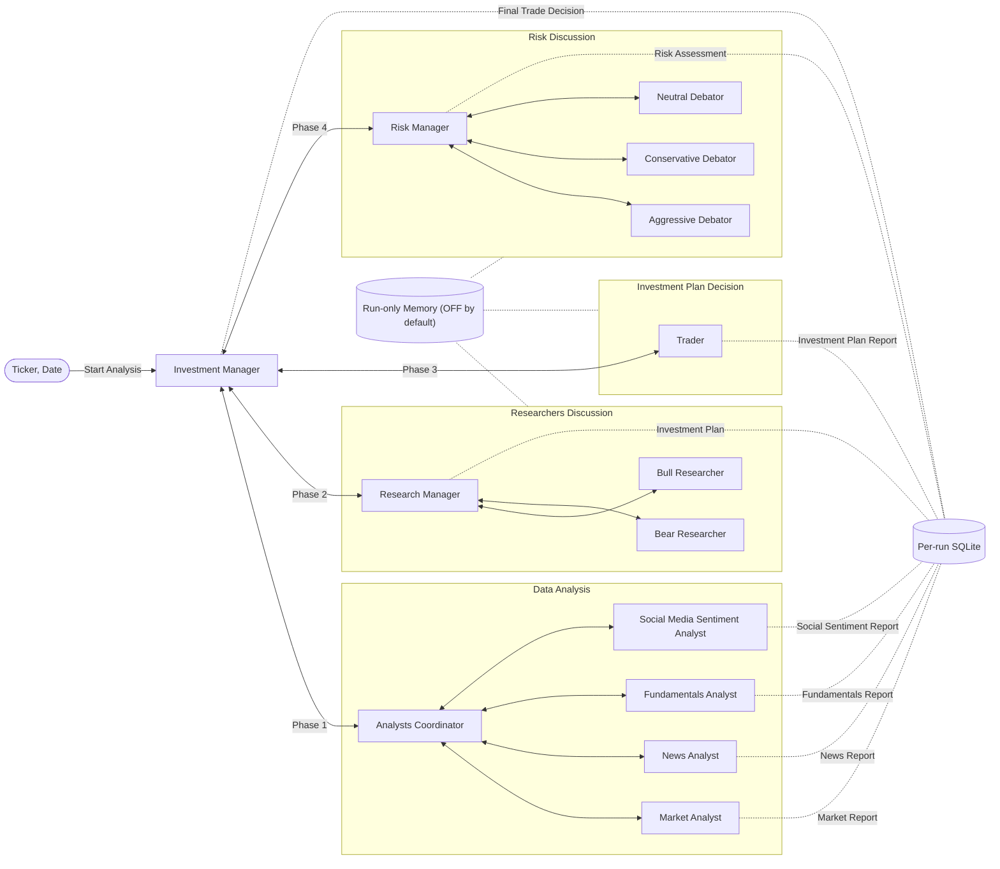

# Investment Agents

This project implements a multi-agent system for investment analysis. It orchestrates various agents (Analysts, Researchers, Traders, Risk Managers) to evaluate financial assets and generate investment recommendations.

## Features

- **Multi-Agent Architecture**: Coordinates specialized agents for fundamental analysis, market analysis, research, trading strategies, and risk management.
- **Automated Workflow**: Runs a complete investment decision from data gathering to final decision.
- **Report Generation**: Generates detailed Markdown reports for each analysis session.
- **Independent runs**: Each analysis has its own state, sessions, caches and report.
- **Model Context Protocol (MCP) Integration**: Leverages MCP servers for data retrieval from various sources (e.g., Finnhub, SimFin).

## Architecture



## Prerequisites

- Python >= 3.13
- [uv](https://github.com/astral-sh/uv) (for dependency management and execution)

## Installation

1.  Clone the repository:
    ```bash
    git clone <repository-url>
    cd InvestmentAgents
    ```

2.  Install dependencies using `uv`:
    ```bash
    uv sync --all-packages
    ```

## Dependency Updates

The root `uv.lock` pins dependencies for the entire workspace, including all MCP
servers. Run dependency commands from the repository root:

```bash
uv lock --upgrade
uv sync --all-packages --locked
uv run python -m unittest discover -s tests -v
uv run pre-commit run --all-files
```

Review major-version changes and update the minimum versions in each affected
`pyproject.toml` after validating compatibility. Keep explicit upper bounds when
required by a service; DuckDuckGo news currently stays on `ddgs` 9.x.
The pre-commit runner stays on 4.5.x for compatibility with Git 2.25 in the
WSL environment; newer runner versions require a newer Git for full-repo scans.

## Configuration

### Environment Variables

Copy `.env.example` to `.env` in the repository root. By default, agents use
Ollama at `http://localhost:11434/v1` with `qwen3:8b`. The template lists per-group
model and endpoint overrides.

Logging defaults to INFO. Set `INVESTMENT_LOG_LEVEL=DEBUG` in `.env` for diagnostics.
Memory is optional and defaults to OFF; pass `memory_mode="RUN_ONLY"` to
`run_analysis` to enable memory within that run.

**Note:** Some MCP servers located in `mcp-servers/` also require their own `.env` files. Please check the individual server directories for specific configuration requirements.

### Data Preparation

Some MCP servers require pre-downloading data before they can be used. You may need to run `download_data.py` scripts located in the `data/` subdirectory of specific MCP servers (e.g., `simfin-fundamentals-data-server`, `finnhub-news-data-server`, `finnhub-fundamentals-data-server`).

## Usage

### Running the Analysis

The main entry point is `main.py`. You can configure the assets, date range, and frequency directly in the `main()` function within `main.py`.

1.  Open `main.py` and modify the configuration section:
    ```python
    def main():
        # Configuration
        assets = ["AAPL"] # Add more assets as needed
        start_date = "2025-07-01"
        end_date = "2025-08-01"
        period_type = "weekly" # Options: "weekly", "biweekly", "monthly"
        # ...
    ```

2.  Run the analysis using `uv`:
    ```bash
    uv run --env-file .env main.py
    ```

### Output

Each analysis writes to `data/runs/<run_id>/`. The command prints the run ID and
Markdown report path.

```text
data/runs/<run_id>/
  report.md                  # investment analysis report
  manifest.json              # run summary
  run.sqlite3                # saved run state
  shared_document.json       # exported analysis results
  sessions/                  # agent conversations
  cache/                     # provider data
  memory/                    # present when memory is enabled
```

## Project Structure

- `agents/`: Contains the implementation of various agents (Investment Manager, Analysts, Researchers, etc.).
- `runtime/`: Run context, SQLite store, lifecycle, sessions, memory workers, MCP resources and artifact publication.
- `data/runs/`: Saved analysis reports and run data.
- `mcp-servers/`: Model Context Protocol servers for data retrieval.
- `utils/`: Utility scripts (e.g., report generation).
- `main.py`: Main script to run the investment analysis workflow.
- `pyproject.toml`: Project configuration and dependencies.

## Licensing and terms of use

Apache-2.0 (see [LICENSE](LICENSE)). For research and educational use only; not
investment advice. Dependencies and the default models (`qwen3:8b`,
`qwen3-embedding`) are permissively licensed. A hosted provider set through
`*_BASE_URL` brings its own terms.

The data sources are the real limit. Yahoo Finance (`yfinance`), the Finnhub and
SimFin free tiers, Reddit's Data API and DuckDuckGo (`ddgs`, unofficial) are for
personal, non-commercial use. Don't redistribute their data or publish run
directories, and get licensed feeds before any commercial use. Set
`REDDIT_USERNAME` for the user agent Reddit requires.

Reddit requires deleted content to be removed from stored copies. When your
research is complete, purge it (dry run unless `--apply`; unfinished runs are
skipped; reports and run state are kept):

```bash
uv run python -B -m utils.purge_reddit [--apply]
```

For a hard-killed run, confirm its process and children have stopped, then add
`--abandoned-run <run_id>`. Legacy data is preserved.
